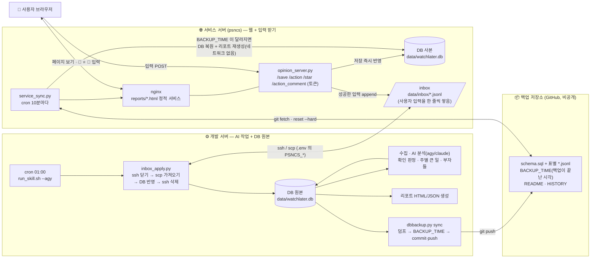
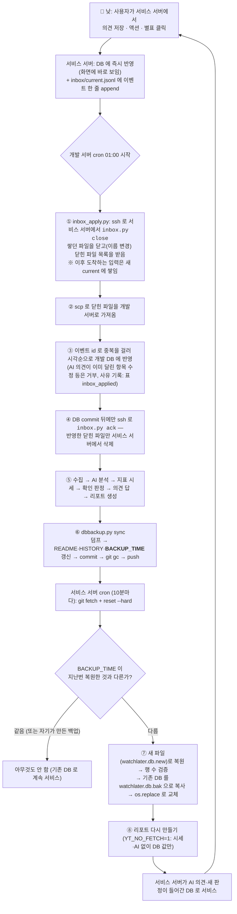

# yt-watcher-later

YouTube 재생목록(예: `my-watch-later`)에 저장해 둔 영상을 매일 새벽 자동으로 수집해
스크립트(자막 원문)를 저장하고, Claude로 요약·분류·분석한 뒤 SQLite와 일별 HTML/JSON
리포트로 정리하는 도구입니다.

## 하는 일

1. `config.toml`의 `[[playlists]]`(소유자 owner별 여러 개)에 적힌 공개/일부공개 재생목록을 읽어 아직 처리하지 않은 영상을 찾는다 (쿠키 불필요).
2. 영상마다 `yt-dlp`로 메타데이터(info.json), 댓글, 자막을 받아 스크립트 텍스트로 정리한다.
3. 영상마다 `claude -p`(Claude 구독 계정, API 키 불필요)를 한 번 호출해 구조화된 분석을 받는다.
   - 카테고리(경제/AI/IT/…)와 2단계 태그, 추가 태그
   - 요약, 키워드, 등장 인물, 언급된 소스·git 링크, 댓글 중 의미 있는 내용
   - 경제 영상: 매크로 국면과 근거, 봐야 할 지표, 나중에 확인할 항목(확인 예정일 포함)
4. 결과를 SQLite(`data/watchlater.db`)에 저장하고, 처리일별 HTML 리포트와 JSON을 만든다.
5. 생방송 출신이라 스크립트가 없던 영상은 7일 뒤 한 번만 다시 시도하고, 그래도 없으면 포기한다.

처리는 3단계다. (1) `fetcher.py`가 yt-dlp로 **병렬 수집**하며 429가 나면 병렬 수를 절반으로 줄이고 잠잠하면 다시 늘린다.
수집 로그는 `logs/collect-날짜.log`에 모은다. (2) 영상별로 Claude를 개별 호출해 분석한다(`parallel_analyze`개 병렬).
(3) 결과를 DB에 저장한다. 실패한 영상은 다음 실행에서 다시 시도하고, 구독 사용량 한도(429)가 나오면 남은 분석을 안전하게 미룬다.
각 영상에는 저장한 사람(`owner`)과 재생목록 이름이 기록되고 리포트에 표시된다.

## 두 가지 역할: 개발 서버 / 서비스 서버

빠른 **개발 서버**가 수집·AI 분석·DB 갱신을 모두 맡고, 느린 **서비스 서버(psncs)** 는 웹 서비스와 사용자 입력 받기만 한다. 둘은 **백업 저장소(git)** 와 **inbox 파일**로만 이어진다.
같은 코드를 두 곳에 두고, 실행하는 컴퓨터가 어느 역할인지는 코드가 스스로 판단한다(`role.py`).

| | 개발 서버 (`dev`) | 서비스 서버 (`service`, psncs) |
|---|---|---|
| 하는 일 | 수집·AI 분석·확인 판정·리포트 생성, **DB 원본** | 웹 서비스(nginx + `opinion_server.py`), 사용자 입력 받기 |
| 매일 | cron 01:00 `run_skill.sh --agy` | cron 10분마다 `service_sync.py` (백업 pull → 복원) |
| DB | 원본. 서비스 서버 입력(inbox)을 맨 처음 반영한 뒤 AI 작업 | 백업에서 **다시 만든 사본**(입력은 고쳐도 다음 복원 때 덮어써짐 — 이미 inbox 로 개발 서버에 갔으므로 상관없음) |
| 백업 | 끝날 때 덤프 → `BACKUP_TIME` 기록 → commit·push | **pull 만** 한다(읽기 전용 사본). `BACKUP_TIME` 2행(만든 컴퓨터)이 **자기 자신이면 복원하지 않는다** — 자기 DB 가 더 새것이라서 |
| 갱신 전 DB 사본 | 일일 실행 시작 때 `data/watchlater.db.bak` 한 개(덮어씀) | 새 백업이 확인돼 **교체하기 직전에만** `data/watchlater.db.bak` 한 개(덮어씀) |
| 입력(의견·액션·별표) | 서비스 서버 inbox 를 가져와 DB 에 반영하고 ack | 저장하면 DB 와 **inbox 에 한 줄씩 쌓는다** |

**역할 판단** (`uv run role.py --why`, `make role`): 환경변수 `YT_ROLE` → 파일 `~/.config/yt-watcher-later/role` → `config.toml` 의 `service_hostnames` 에 이 컴퓨터 이름이 있으면 `service`, 없으면 `dev`.
`config.toml` 의 `split_from`(분리 시작 시각) **전에는** 서비스 서버도 예전처럼 전부 한다(`legacy`). 개발 서버는 그 시각 전에는 실행하지 않는다. 현재 `split_from = "2026-11-27 06:00"` — 11/27 01:00 새벽 실행까지는 psncs 가 기존과 똑같이 돈다.

### 구조도



### 하루의 진행 순서



**문제가 생기면 어디를 볼까**
- `make backup-status` — 백업 저장소의 마지막 백업 시각(`BACKUP_TIME`)과 서비스 서버가 마지막으로 복원한 시각. 둘이 다르면 아직 복원 전, 백업 시각이 오래됐으면 개발 서버 쪽에서 멈춘 것이다.
- `make inbox-status`(서비스 서버) — 개발 서버가 아직 안 가져간 입력 수. 계속 쌓이면 개발 서버가 안 도는 것.
- 개발 서버 `logs/daily.log`(inbox 반영 줄·백업 push 줄), 서비스 서버 `logs/service.log`.
- 백업 저장소 `HISTORY.md` — 백업마다 한 줄(시각·행 수·바뀐 표).

### 처음 설정과 자주 쓰는 명령
| 대상 | 명령 |
|---|---|
| 개발 서버 처음 한 번 | `make dev-init` (백업 저장소 clone + DB 복원) → 프로젝트 폴더에 **`.env`**(필수) 를 만들고 `PSNCS_HOST`·`PSNCS_ID`·`PSNCS_YT_WATCH_DIR`(필수; 선택 `PSNCS_PORT`·`PSNCS_PASSWD`·`PSNCS_SSH_OPTS`) 기재 → `make inbox-dry`(ssh 연결 확인) → `make cron-dev`. **`.env` 가 없거나 `PSNCS_*` 필수 값이 없으면 `inbox_apply.py` 가 오류(종료코드 2)를 내고 `run_skill.sh` 가 개발 서버 실행을 멈춘다.** 접속은 ssh 키(권장) 또는 `PSNCS_PASSWD`(`sshpass` 필요: `sudo apt install sshpass`)로 한다 |
| 서비스 서버 처음 한 번 | `make cron-service` (10분마다 `service_sync.py`; 분리가 끝나면 예전 01:00 `run_skill.sh` 줄은 지운다) → `make opinion-restart`(입력 서버가 inbox 를 쌓도록 코드 반영) |
| 상태 확인 | `make role` · `make backup-status` · `make inbox-status` |
| 수동 실행 | 개발: `make daily` · `make inbox-apply` / 서비스: `make service-sync` · `make service-force` |

### 개발 서버 `.env` 예
```
PSNCS_HOST='psncs.iptime.org'
PSNCS_ID='cheoljoo'
PSNCS_YT_WATCH_DIR='~/code/yt-watcher-later'   # 서비스 서버의 프로젝트 폴더(inbox 는 그 아래 data/inbox)
PSNCS_PORT=22443
# PSNCS_PASSWD='...'          # 비밀번호 접속일 때만(sshpass 필요). 가능하면 ssh 키를 등록하고 이 줄은 쓰지 않는다
# PSNCS_SSH_OPTS=-i ~/.ssh/id_ed25519
```
`.env` 는 git 에 올라가지 않는다(.gitignore). 이름은 `ssh`/`scp` 가 접속하는 곳일 뿐이라, 서비스 서버 쪽에는 이 값이 필요 없다.

### 내일(11/27) 새벽 이후 단계별 확인 순서
1. **(01:00 이후) psncs**: 평소처럼 돈 기록 확인 — `tail logs/daily.log`("DB 백업 … push 완료"), `make backup-status`(백업 시각이 오늘 새벽).
2. **psncs**: `make role` → 06:00 이후면 `service`. `make cron-service`(10분마다 복원 확인) 와 `make opinion-restart`(입력 서버가 새 코드로 inbox 를 쌓도록) 실행. 이후 브라우저에서 의견·별표를 하나 눌러 보고 `make inbox-status` 가 1건 이상인지 확인.
3. **개발 서버**: `make dev-init`(백업 clone + DB 복원) → `.env` 작성 → `make role`(`dev`) → `make inbox-dry`(ssh 로 쌓인 입력 개수가 보이는지).
4. **개발 서버**: `make inbox-apply`(2번에서 누른 입력이 반영되고 psncs 의 파일이 지워지는지) → `make daily`(전체 한 번 돌려 백업 push 까지) → 로그에서 inbox 줄과 push 줄 확인.
5. **psncs**: 10분 안에(또는 `make service-sync`) 새 백업 시각을 보고 복원했는지 — `make backup-status` 에서 두 시각이 같아지고 `logs/service.log` 에 "복원 완료".
6. **개발 서버**: `make cron-dev` 로 매일 01:00 등록. (psncs 는 2026-11-27 에 예전 01:00 `run_skill.sh` 줄을 지우고 10분 `service_sync.py` 줄만 남겼다.)

**입력 서버를 고쳤거나 `git pull` 한 뒤에는 반드시 `make opinion-restart`** — 떠 있는 서버는 옛 코드로 계속 돌아 inbox 를 쌓지 않을 수 있다.

주의: 서비스 서버의 백업 폴더(`~/yt-watcher-later-backup`)는 `service_sync.py` 가 원격과 똑같이 맞추는(reset --hard) 읽기 전용 사본이다. 거기서 직접 commit·push 하지 않는다.

## 구성

| 파일 | 역할 |
|---|---|
| `main.py` | 전체 흐름 (재생목록 → 수집 → 분석 → 저장 → 리포트) |
| `fetch_list.py` | 재생목록 조회 |
| `fetcher.py` | 병렬·적응형 수집 + 로그 모음 |
| `collect.py` | yt-dlp로 info.json·댓글·자막 수집 (429 재시도 포함) |
| `vtt_to_text.py` | VTT 자막 → 중복 제거한 텍스트 |
| `analyze.py` | `claude -p --json-schema`로 구조화 분석 |
| `db.py` | SQLite 스키마 (videos, people, links, tags, checks) |
| `report.py` | 일별 HTML 리포트 (카테고리 → 주제 → 업로드일 순) |
| `stats.py` | 시청 성향 분석 페이지(`stats.html`): 많이 보는 채널·자주 나오는 인물 (DB만 사용, 리포트 생성 끝에 실행) |
| `highlight.py` | 인상 깊은 영상 모음(`highlights.html`): 영상 카드의 ☆ 버튼으로 별표(`stars` 표)를 단 영상이 보인다. `/yt-highlight URL` 스킬이 상세 분석을 만들어 `submit` 하면 자동으로 별표가 달린다 (별표만 단 영상은 일일 리포트 요약 카드로 보임) |
| `opinions.py` / `opinion_server.py` | 영상 카드의 '나의 의견' 칸 → 저장 서버(127.0.0.1:8650, nginx `/yt_watch_later/api/`, 토큰 `~/.config/yt-watcher-later/token`, systemd 사용자 서비스 `yt-opinion`) → `opinions`·`actions`·`stars` 표(💬 의견·🎯 직접 해보기·⭐ 인상 깊은 영상 버튼). cron 이 AI 의견을 채우고 `opinions.html`(나와 AI 의견)을 만든다 |
| `export_json.py` | DB → 사람이 읽기 좋은 JSON |
| `check.py` | 확인 항목 결과 기록, 시청일 기록 |
| `run_daily.sh` | cron 진입점 — 항목마다 `claude -p` 를 호출하는 방식 (중복 실행 방지) |
| `run_skill.sh` | cron 진입점 — **스킬 모드**: 수집(코드) → Claude 세션 1개가 `yt-daily` 스킬로 모든 작업 처리 → 리포트(코드) |
| `work.py` | 스킬 모드 작업 관리자 (`collect`/`start`/`next`/`submit`/`skip`/`status`/`finish`) |
| `.claude/skills/yt-daily/` | 스킬 정의. `work.py next` 로 작업을 받아 JSON 을 만들어 제출하는 반복 절차 |
| `config.toml` | 재생목록 URL, 언어, 모델 등 설정 |

## 요구 사항

- Linux, [uv](https://docs.astral.sh/uv/), Python 3.13
- `yt-dlp` (uv tool 등으로 설치)
- Claude Code CLI(`claude`)에 구독 계정으로 로그인되어 있을 것
- 대상 재생목록은 **공개 또는 일부 공개**여야 한다. ("나중에 볼 동영상(WL)"은 로그인 쿠키가
  필요하고 세션이 자주 무효화되어 자동화에 맞지 않는다.)

## 사용법

```bash
# config.toml 의 playlist_url 을 본인 재생목록으로 수정한 뒤
uv run main.py                 # 새 영상 전부 처리
uv run main.py --limit 3       # 최대 3개만
uv run main.py --only VIDEO_ID # 특정 영상만 (이미 처리했어도 다시)
uv run main.py --show-top 20   # 재생목록 상위 20개 보기

uv run export_json.py          # reports/watchlater.json (스크립트 원문 제외)
uv run export_json.py --full   # data/watchlater_full.json (원문 포함)

uv run check.py list --due     # 확인할 시점이 된 항목
uv run check.py set ID --status confirmed --result "..." --opinion "..." --reason "..."
uv run check.py watched VIDEO_ID [YYYY-MM-DD]
```

스킬 모드(권장 실험): 스킬 안에서는 `claude -p` 를 다시 호출하지 않는다. cron 이 `claude -p /yt-daily` 를 **한 번**
실행하면, 그 세션이 `work.py next`로 DB의 대기 작업(영상 분석·지표 설명·출처 매핑·의미 해설·매크로 위치·확인 판정)을
차례로 받아 `submit` 한다. 수집은 새 영상을 전부 하지만, **Claude 영상 분석은 한 번 실행에 최대 `max_analyze`(config.toml, 기본 30)개**이고 나머지는 다음 날로 넘어간다(재생목록 앞쪽부터). 아직 분석되지 않은 영상 수는 `reports/index.html`(과 오늘 리포트)에 표시된다. 입력이 세션 한도(`BUDGET`, 기본 70만자)를 넘으면 다음 라운드(`ROUNDS`, 기본 4)에서 이어간다.

매일 자동 실행 예 (crontab):

```
0 1 * * * /path/to/yt-watcher-later/run_daily.sh >> /path/to/yt-watcher-later/logs/daily.log 2>&1
```

`run_daily.sh`의 `cd` 경로와 `PATH`는 환경에 맞게 고쳐서 쓴다.

## 산출물

- `data/<영상ID>/` — `transcript.txt`, 자막 원본(`.vtt`), `info.json`, `analysis.json`, `summary.md`
- `data/watchlater.db` — SQLite (스크립트 원문 포함)
- `reports/YYYY-MM-DD.html`, `reports/index.html`, `reports/watchlater.json`

이 산출물에는 개인 시청 기록이 담기므로 저장소에는 올리지 않는다 (`.gitignore`).
리포트를 웹으로 공개할 때는 `reports/` 폴더만 노출하고, 접근 제한 여부를 스스로 판단할 것.

## 주의

- YouTube가 요청이 많으면 `HTTP 429`를 돌려준다. 한글 자막을 먼저 받고 없을 때만 영어를
  요청하며, 요청 간 대기와 재시도를 둔다.
- 요약·분류·전망은 모델의 해석이며 자막은 자동 음성인식이라 오인식이 있을 수 있다.
  투자 판단의 근거로 쓰기 전에 원문과 대조할 것.

## 라이선스

Apache License 2.0 — [LICENSE](LICENSE) 참고.

## DB 백업/복구
`uv run dbbackup.py dump` 는 DB 를 `~/yt-watcher-later-backup`(또는 `$YT_BACKUP_DIR`)에 `schema.sql` + 표별 `<표>.jsonl`(행당 한 줄, 기본키 순)로 저장한다. 바뀐 행만 git diff 에 나타난다. 폴더가 있으면 `work.py finish` 가 덤프하고, `run_skill.sh` 끝에서 `dbbackup.py sync` 가 README.md·HISTORY.md(백업 시각·변경 내역) 갱신 + 백업 저장소 commit·push 까지 자동으로 한다(`make backup-push` 로 수동 실행). 복구: `uv run dbbackup.py restore 백업폴더 새DB경로`, 비교: `verify`. 개인 의견·자막이 들어 있으므로 공개 저장소가 아닌 별도 비공개 저장소에 둘 것.

- **이 방식을 선택한 이유**:
  - **Git LFS 대신 일반 Git 텍스트 증분 사용**: GitHub 무료 계정의 Git LFS는 스토리지 10GiB / 월 대역폭 10GiB 제한이 있고, 바이너리는 커밋마다 파일 전체가 새로 누적된다(예: 350MB DB를 매일 커밋하면 한 달에 10GiB를 초과). 반면 일반 Git은 텍스트의 바뀐 줄(diff)만 압축 저장하므로 DB 전체 크기가 커져도 매일 추가되는 증분만큼만 쌓여 무료 한도 안에서 장기간 유지할 수 있다.
  - **단일 파일 100MB 제한 대응**: GitHub은 단일 파일 50MB 초과 시 경고, 100MB 초과 시 push를 차단한다. 이를 피하기 위해 `dbbackup.py`는 표 하나가 40MB를 넘으면 약 25MB 단위의 여러 조각(`<표>.s00.jsonl`, `.s01.jsonl` …)으로 자동 분할하며, 기본키 해시로 조각을 배정해 행이 늘어나도 기존 행이 제자리에 유지되도록 설계했다.
- **향후 `.git` 크기가 문제가 될 때의 대안 (GitHub Releases)**:
  - 장기 운영으로 `.git` 히스토리 자체가 커져 부담이 되면, 비공개 백업 저장소의 **GitHub Releases**에 `latest` 태그만 유지하면서 SQLite 스냅샷(`sqlite3 ... ".backup ..."` 후 압축)을 `gh release upload latest <파일> --clobber`로 덮어쓰는 방식으로 전환하면 된다(파일당 최대 2GB, LFS 한도 미사용, 히스토리 미누적).

## 자막을 못 받을 때 (YouTube 429)
- 영상 정보(제목·설명·댓글)는 받았는데 자막 요청만 429 로 막히면 영상을 실패 처리하지 않는다. 제목·설명·댓글만으로 분석하고 `transcript_status='meta_only'` 로 표시한다(카드에 📝 '자막을 받지 못해 … 내용 정확도가 낮습니다').
- 다음 날부터 자막만 다시 받아 보고(최대 5회), 받으면 그 영상을 다시 분석해 `ok` 로 바꾼다. 5회 실패하면 `gave_up`.
- 자막 429 도 병렬 수 조절 신호로 쓴다. agy 로 영상 내용을 기술시켜 자막 대신 쓰는 방식은 시험 결과 영상 본문을 읽지 못해 채택하지 않았다.
- **폴백**: yt-dlp 가 자막을 못 받으면(429 포함, 진행 중 라이브 제외) `youtube-transcript-api` 로 한 번 더 시도한다. 받으면 `transcript_lang` 이 `ko (transcript-api)` 처럼 출처가 구분되어 저장되고, 그래도 실패하면 위의 meta_only(설명·댓글 기반) 경로로 이어진다.
